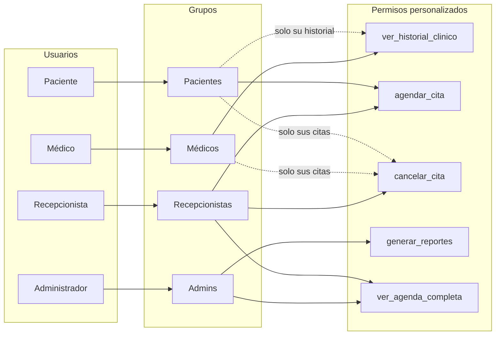

# Roles y permisos implementados

## Diagrama

Las líneas punteadas indican que, además del permiso, la vista aplica una **regla a nivel de objeto**.

## Matriz

| Permiso / acción | Admins | Médicos | Recepcionistas | Pacientes |
|---|:-:|:-:|:-:|:-:|
| `ver_historial_clinico` | — | ✔ (todos) | — | ✔ (solo propio) |
| `agendar_cita` | — | — | ✔ | ✔ (para sí mismo) |
| `cancelar_cita` | — | ✔ (sus citas) | ✔ | ✔ (sus citas) |
| `generar_reportes` | ✔ | — | — | — |
| `ver_agenda_completa` | ✔ | — | ✔ | — |
| Registrar consulta (`add_consulta`) | — | ✔ (sus citas) | — | — |
| Agregar notas (`add_notaconsulta`) | — | ✔ | — | — |
| Registrar / editar pacientes | ✔ | — | ✔ | — |
| Gestionar médicos, horarios y especialidades | ✔ | — | solo lectura | — |
| Ver auditoría (`view_accesohistorial`, `view_registrocambio`) | ✔ | — | — | — |
| Acceso a Django Admin (`is_staff`) | ✔ | — | ✔ | — |

> Los administradores **no** tienen `ver_historial_clinico`: la gestión del sistema no requiere acceder al contenido clínico (principio de mínimo privilegio).

## Dónde se implementa

| Capa | Archivo |
|---|---|
| Definición rol → grupo → permisos | `clinica/roles.py` (se sincroniza con cada `migrate`) |
| Permisos personalizados | `Meta.permissions` de `Paciente` y `Cita` en `clinica/models.py` |
| Protección de vistas | `@login_required` + `@permission_required(..., raise_exception=True)` en `clinica/views.py` |
| Reglas por objeto | `puede_ver_historial()`, `Cita.puede_ser_cancelada_por()`, `CitaQuerySet.visibles_para()` |
| Auditoría de accesos | `AuditoriaMedicaMiddleware` + decorador `@informacion_sensible` |
